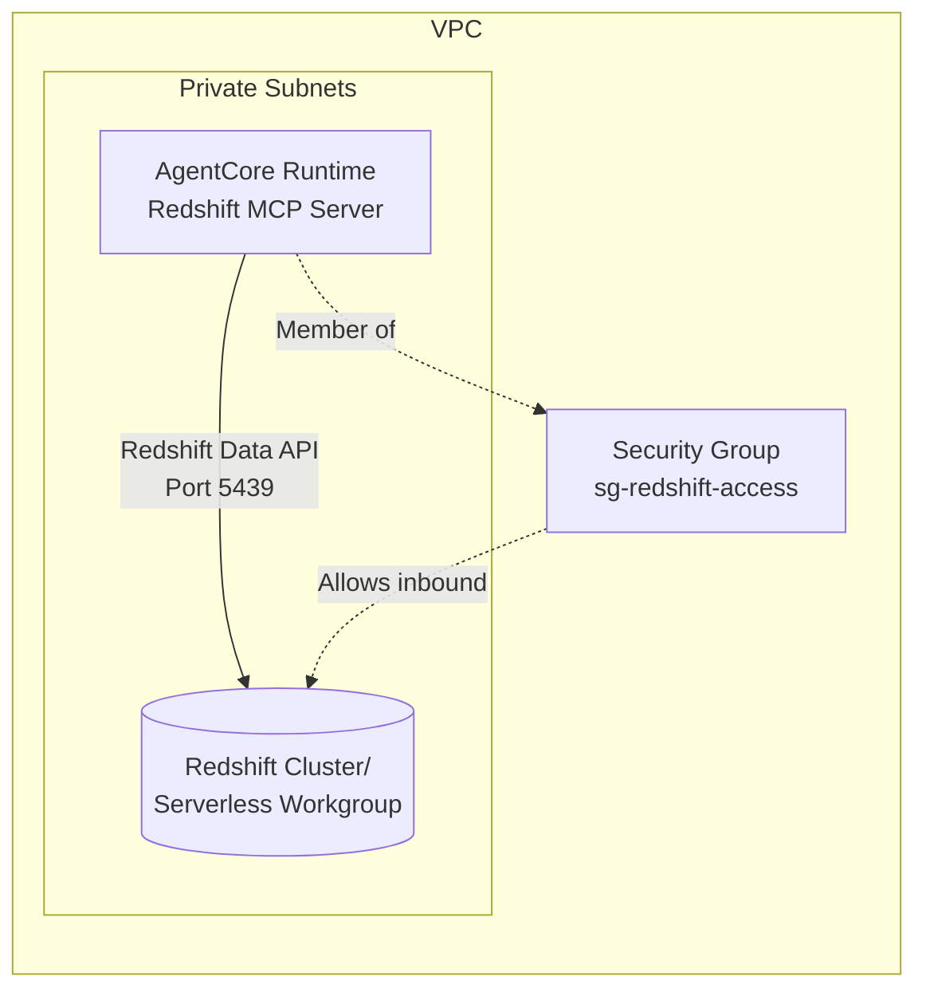
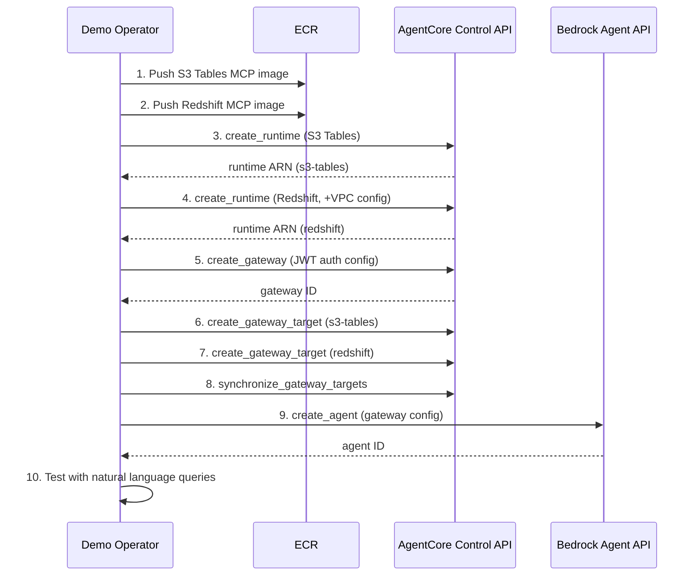

# Design Document: MCP AgentCore Demo — D&A Analytics Gateway

## Overview

This project deploys two open-source AWS Labs MCP servers (S3 Tables and Redshift) onto Amazon Bedrock AgentCore Runtime, fronts them with a unified AgentCore Gateway, and connects a Bedrock Agent for natural language data exploration. The architecture eliminates the need for custom Fargate/Lambda MCP hosting, bespoke auth services, and load balancers — replacing them with managed AgentCore infrastructure.

The demo is implemented as a Python CDK project (infrastructure) plus Python deployment/orchestration scripts that provision the AgentCore resources, prepare sample data, and validate end-to-end connectivity. No custom application code is required for the MCP servers themselves — they are off-the-shelf AWS Labs containers.

### Key Design Decisions

1. **AgentCore Runtime over ECS/Fargate** — Serverless, auto-scales to zero, session isolation via microVM, no cluster management. Directly addresses Derek's architecture diagram where Fargate hosts MCP servers.
2. **Single Gateway, multiple targets** — Both MCP servers register under one AgentCore Gateway. The agent discovers tools semantically from a single endpoint, eliminating the need for a custom load balancer or router.
3. **Stateless HTTP protocol** — Both MCP servers use stateless HTTP mode (recommended for basic MCP servers that don't require long-lived sessions). This simplifies deployment and enables horizontal scaling.
4. **Cognito JWT authorizer** — Demonstrates enterprise auth integration without custom auth service code. Replaceable with Entra ID JWT for AnyCompany's Azure AD environment.
5. **Python CDK for infrastructure** — Aligns with the `consumer-regulatory-agent/` project pattern in the workspace and provides type-safe infrastructure definitions.
6. **eu-west-1 region** — Matches AnyCompany's AWS region preference and Bedrock AgentCore availability.

## Architecture

### High-Level Architecture

```mermaid
graph TB
    subgraph "AWS Cloud (eu-west-1)"
        subgraph "Amazon Bedrock"
            AGENT[Bedrock Agent<br/>da-analytics-agent<br/>Claude Sonnet 4]
        end

        subgraph "AgentCore Gateway"
            GW[da-analytics-gateway<br/>• JWT Auth (Cognito/Entra ID)<br/>• Tool Discovery<br/>• Routing & Observability]
        end

        subgraph "AgentCore Runtime"
            RT1[S3 Tables MCP Server<br/>• Serverless (auto-scale)<br/>• Session isolation (microVM)<br/>• Read-only by default]
            RT2[Redshift MCP Server<br/>• Serverless (auto-scale)<br/>• VPC connectivity<br/>• Read-only enforcement]
        end

        subgraph "Data Sources"
            S3T[(S3 Tables<br/>Apache Iceberg<br/>• customers<br/>• transactions<br/>• risk_scores)]
            RS[(Amazon Redshift<br/>• Provisioned cluster<br/>• Serverless workgroup<br/>• sample_data_dev)]
        end

        subgraph "Supporting Services"
            ECR[ECR<br/>Container Images]
            COG[Cognito User Pool<br/>JWT Issuer]
            CT[CloudTrail<br/>Audit Logs]
        end
    end

    USER[User / Agent Client] --> AGENT
    AGENT --> GW
    GW --> RT1
    GW --> RT2
    RT1 --> S3T
    RT2 --> RS
    ECR -.->|Image Pull| RT1
    ECR -.->|Image Pull| RT2
    COG -.->|JWT Validation| GW
    CT -.->|Audit| GW
```

### Network Architecture (Redshift VPC Connectivity)



### Deployment Flow



## Components and Interfaces

### Infrastructure Components

| Component | Type | Purpose |
|-----------|------|---------|
| `S3TablesMCPRuntime` | AgentCore Runtime | Hosts s3-tables-mcp-server container |
| `RedshiftMCPRuntime` | AgentCore Runtime | Hosts redshift-mcp-server container with VPC |
| `DAAnalyticsGateway` | AgentCore Gateway | Unified entry point with JWT auth |
| `S3TablesTarget` | Gateway Target | Routes to S3 Tables runtime |
| `RedshiftTarget` | Gateway Target | Routes to Redshift runtime |
| `DAAnalyticsAgent` | Bedrock Agent | NL interface connected to gateway |
| `S3TablesMCPRepo` | ECR Repository | Stores S3 Tables MCP server image |
| `RedshiftMCPRepo` | ECR Repository | Stores Redshift MCP server image |
| `MCPAuthPool` | Cognito User Pool | JWT issuer for gateway auth |
| `AgentCoreS3TablesRole` | IAM Role | Runtime role for S3 Tables access |
| `AgentCoreRedshiftRole` | IAM Role | Runtime role for Redshift Data API access |

### AgentCore Control API Interface

#### create_runtime (S3 Tables)

```python
client.create_runtime(
    name='s3-tables-mcp-server',
    description='S3 Tables MCP Server for D&A domain',
    containerConfig={
        'imageUri': '<account>.dkr.ecr.eu-west-1.amazonaws.com/s3-tables-mcp-server:latest',
        'environmentVariables': {
            'AWS_REGION': 'eu-west-1',
            'FASTMCP_LOG_LEVEL': 'INFO'
        }
    },
    protocolConfig={
        'mcpConfig': {
            'statelessHttp': True
        }
    },
    roleArn='arn:aws:iam::<account>:role/AgentCoreS3TablesRole'
)
# Returns: { 'runtimeArn': 'arn:aws:bedrock-agentcore:eu-west-1:<account>:runtime/s3-tables-mcp-server' }
```

#### create_runtime (Redshift)

```python
client.create_runtime(
    name='redshift-mcp-server',
    description='Redshift MCP Server for D&A analytics queries',
    containerConfig={
        'imageUri': '<account>.dkr.ecr.eu-west-1.amazonaws.com/redshift-mcp-server:latest',
        'environmentVariables': {
            'AWS_REGION': 'eu-west-1',
            'FASTMCP_LOG_LEVEL': 'INFO'
        }
    },
    protocolConfig={
        'mcpConfig': {
            'statelessHttp': True
        }
    },
    networkConfig={
        'vpcConfig': {
            'subnetIds': ['subnet-xxx', 'subnet-yyy'],
            'securityGroupIds': ['sg-redshift-access']
        }
    },
    roleArn='arn:aws:iam::<account>:role/AgentCoreRedshiftRole'
)
# Returns: { 'runtimeArn': 'arn:aws:bedrock-agentcore:eu-west-1:<account>:runtime/redshift-mcp-server' }
```

#### create_gateway

```python
client.create_gateway(
    name='da-analytics-gateway',
    description='D&A Domain MCP Gateway for analytics tools',
    authorizationConfig={
        'customJWTAuthorizer': {
            'allowedClients': ['<cognito_client_id>'],
            'allowedAudiences': ['<cognito_pool_arn>'],
            'issuerUrl': 'https://cognito-idp.eu-west-1.amazonaws.com/<pool_id>'
        }
    }
)
# Returns: { 'gatewayId': 'gw-xxxxxxxxxx' }
```

#### create_gateway_target

```python
client.create_gateway_target(
    gatewayId='gw-xxxxxxxxxx',
    name='s3-tables',
    description='S3 Tables discovery and query tools',
    targetConfig={
        'mcpServerTarget': {
            'runtimeArn': '<s3_tables_runtime_arn>'
        }
    }
)
```

#### synchronize_gateway_targets

```python
client.synchronize_gateway_targets(gatewayId='gw-xxxxxxxxxx')
# Triggers tool discovery — gateway introspects registered runtimes for available MCP tools
```

### Bedrock Agent API Interface

#### create_agent

```python
bedrock_client.create_agent(
    agentName='da-analytics-agent',
    foundationModel='anthropic.claude-sonnet-4-20250514',
    instruction='''You are a data analytics assistant for the D&A team. 
Use the available tools to discover and query S3 Tables and Redshift data sources.
Always explain what data you found and present results clearly.
When asked to compare data across sources, query both and synthesise results.''',
    agentCoreGatewayConfig={
        'gatewayId': 'gw-xxxxxxxxxx'
    }
)
# Returns: { 'agentId': 'agent-xxxxxxxxxx' }
```

### MCP Tool Interfaces

#### S3 Tables MCP Server — Exposed Tools

| Tool Name | Input | Output |
|-----------|-------|--------|
| `list_table_buckets` | `{}` | `{ buckets: [{ name, arn, createdAt }] }` |
| `list_namespaces` | `{ tableBucketArn }` | `{ namespaces: [{ name, tableCount }] }` |
| `list_tables` | `{ tableBucketArn, namespace }` | `{ tables: [{ name, format, createdAt }] }` |
| `get_table_metadata` | `{ tableBucketArn, namespace, tableName }` | `{ schema, storageInfo, maintenanceConfig }` |
| `query_table` | `{ tableBucketArn, namespace, tableName, sql }` | `{ columns, rows, rowCount }` |

#### Redshift MCP Server — Exposed Tools

| Tool Name | Input | Output |
|-----------|-------|--------|
| `list_clusters` | `{}` | `{ clusters: [{ id, status, nodeType }], workgroups: [{ name, status }] }` |
| `list_databases` | `{ clusterOrWorkgroup }` | `{ databases: [{ name }] }` |
| `list_schemas` | `{ clusterOrWorkgroup, database }` | `{ schemas: [{ name }] }` |
| `list_tables` | `{ clusterOrWorkgroup, database, schema }` | `{ tables: [{ name, type }] }` |
| `list_columns` | `{ clusterOrWorkgroup, database, schema, table }` | `{ columns: [{ name, type, nullable }] }` |
| `execute_query` | `{ clusterOrWorkgroup, database, sql }` | `{ columns, rows, rowCount }` |

### IAM Role Definitions

#### AgentCoreS3TablesRole

```json
{
  "Version": "2012-10-17",
  "Statement": [
    {
      "Effect": "Allow",
      "Action": ["s3tables:*"],
      "Resource": "*"
    },
    {
      "Effect": "Allow",
      "Action": ["s3:GetObject", "s3:ListBucket"],
      "Resource": ["arn:aws:s3:::*"]
    }
  ]
}
```

Trust policy: `bedrock-agentcore.amazonaws.com`

#### AgentCoreRedshiftRole

```json
{
  "Version": "2012-10-17",
  "Statement": [
    {
      "Effect": "Allow",
      "Action": [
        "redshift:DescribeClusters",
        "redshift:GetClusterCredentials",
        "redshift-serverless:ListWorkgroups",
        "redshift-serverless:GetWorkgroup",
        "redshift-data:ExecuteStatement",
        "redshift-data:GetStatementResult",
        "redshift-data:DescribeStatement",
        "redshift-data:ListStatements"
      ],
      "Resource": "*"
    }
  ]
}
```

Trust policy: `bedrock-agentcore.amazonaws.com`

## Data Models

### Sample Data Structure — S3 Tables

```
S3 Table Bucket: anycompany-da-analytics
├── Namespace: customers
│   └── Table: customer_profiles (Iceberg)
│       Columns: customer_id, name, segment, region, onboarded_date, lifetime_value
│       Rows: ~1000 sample records
├── Namespace: transactions
│   └── Table: monthly_transactions (Iceberg)
│       Columns: txn_id, customer_id, amount, category, txn_date, channel
│       Rows: ~5000 sample records
└── Namespace: risk_scores
    └── Table: credit_risk_scores (Iceberg)
        Columns: customer_id, score, model_version, calculated_date, risk_band
        Rows: ~1000 sample records
```

### Sample Data Structure — Redshift

```
Cluster: anycompany-analytics (provisioned)
└── Database: analytics_db
    └── Schema: public
        ├── Table: customers (mirrors S3 Tables customer_profiles)
        ├── Table: monthly_sales (aggregated transaction data)
        └── Table: risk_assessments (enriched risk data)

Workgroup: anycompany-etl-serverless (serverless)
└── Database: etl_staging
    └── Schema: staging
        └── Table: raw_feeds (ETL staging data)
```

### Configuration Data Model

```python
# config.py — deployment configuration

@dataclass
class AgentCoreConfig:
    region: str = "eu-west-1"
    account_id: str = ""  # Set via environment or CDK context

    # ECR
    s3_tables_repo_name: str = "s3-tables-mcp-server"
    redshift_repo_name: str = "redshift-mcp-server"

    # AgentCore Runtime
    s3_tables_runtime_name: str = "s3-tables-mcp-server"
    redshift_runtime_name: str = "redshift-mcp-server"

    # AgentCore Gateway
    gateway_name: str = "da-analytics-gateway"
    s3_tables_target_name: str = "s3-tables"
    redshift_target_name: str = "redshift-analytics"

    # Cognito
    cognito_pool_name: str = "da-analytics-pool"

    # Agent
    agent_name: str = "da-analytics-agent"
    agent_model: str = "anthropic.claude-sonnet-4-20250514"

    # VPC (Redshift connectivity)
    vpc_subnet_ids: list = field(default_factory=list)
    vpc_security_group_ids: list = field(default_factory=list)
```

## Project Folder Structure

```
agent-core-mcp-demo/
├── infra/
│   ├── app.py                    # CDK app entry point
│   ├── stacks/
│   │   ├── ecr_stack.py          # ECR repositories
│   │   ├── iam_stack.py          # IAM roles for AgentCore runtimes
│   │   ├── cognito_stack.py      # Cognito user pool for JWT auth
│   │   └── vpc_stack.py          # VPC/subnet/SG for Redshift connectivity
│   ├── cdk.json
│   └── requirements.txt
├── deploy/
│   ├── build_and_push.sh         # Build Docker images, push to ECR
│   ├── deploy_runtimes.py        # Create AgentCore runtimes via boto3
│   ├── deploy_gateway.py         # Create gateway, register targets, sync
│   ├── deploy_agent.py           # Create Bedrock Agent with gateway config
│   └── teardown.py               # Clean up all resources
├── data/
│   ├── seed_s3_tables.py         # Create S3 Tables bucket, namespaces, load CSVs
│   ├── seed_redshift.py          # Create Redshift tables, load sample data
│   └── sample/
│       ├── customers.csv
│       ├── transactions.csv
│       └── risk_scores.csv
├── demo/
│   ├── demo_script.md            # Step-by-step demo walkthrough
│   ├── talking_points.md         # Key messages per demo section
│   └── test_queries.py           # Automated test queries against the agent
├── docs/
│   ├── architecture_mapping.md   # Derek's diagram → AgentCore mapping
│   └── setup_guide.md            # Prerequisites and deployment instructions
├── pyproject.toml
└── README.md
```

## Mapping to Derek's MCP Architecture Diagram

| Derek's Component | AgentCore Replacement | Benefit |
|---|---|---|
| MCP Servers (Fargate/Lambda) | AgentCore Runtime (serverless, managed) | No cluster management, auto-scales to zero |
| MCP Auth Service | AgentCore Gateway auth (Cognito / Entra ID JWT) | No custom auth code, enterprise IdP integration |
| AWS Load Balancer (for MCP) | AgentCore Gateway (built-in routing + discovery) | Semantic tool search, single endpoint |
| Amazon Cognito (manual config) | AgentCore Gateway authorizer (integrated) | Declarative config, no custom middleware |
| Amazon DynamoDB (session state) | AgentCore Runtime session management (automatic) | No state management code needed |
| ECR (container registry) | Still used — images pushed to ECR, deployed by AgentCore | Unchanged |
| CloudWatch / Secrets Manager | Still used — AgentCore integrates natively | Unchanged |
| Transit Gateway | Still used for cross-VPC connectivity (Redshift) | Unchanged |
| MuleSoft MCP Gateway | Remains as enterprise cross-domain layer (not replaced) | AgentCore is AWS-internal, MuleSoft is cross-org |
