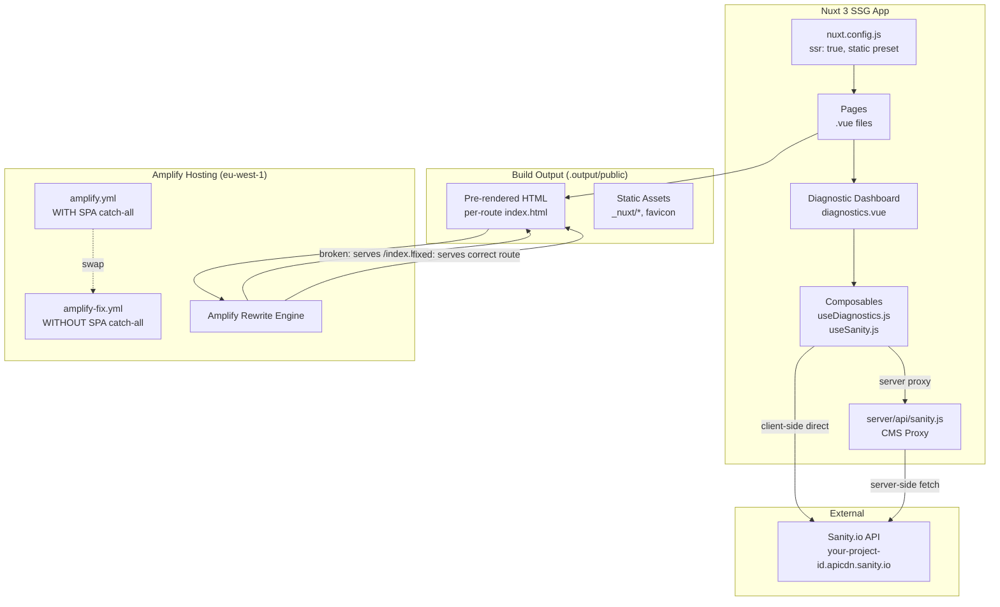
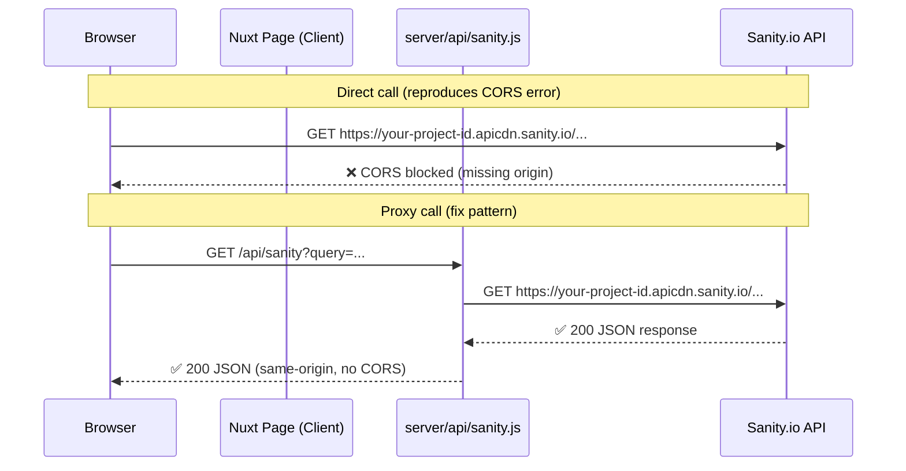

# Design Document

## Overview

This design describes a minimal Nuxt 3 Static Site Generation (SSG) application that reproduces the exact issues experienced by AnyCompany on AWS Amplify Hosting. The app serves as a diagnostic tool to confirm root causes (direct URL 404s, SPA rewrite conflicts, CORS errors from Sanity.io, trailing slash failures, and all-routes-redirect-to-home behavior) traced to Amplify's default rewrite/redirect rules (aws-amplify/amplify-hosting#3829).

The reproduction app is intentionally lightweight: JavaScript only (no TypeScript), Node.js 22, deployed to eu-west-1, no Lambda/API Gateway — just Amplify Hosting. It includes two Amplify build specs (`amplify.yml` for broken behavior, `amplify-fix.yml` for the fix) and a built-in diagnostic dashboard that automatically tests all issue scenarios.

### Key Design Decisions

1. **JavaScript only** — All files use `.js` or `.vue` extensions. `nuxt.config.js` instead of `.ts`. This keeps the repro simple and avoids build tooling complexity.
2. **Nuxt server routes for CMS proxy** — Instead of API Gateway or Lambda, the app uses Nuxt's built-in `server/api/` routes to proxy Sanity.io calls. This avoids CORS entirely for server-side requests and keeps infrastructure minimal.
3. **Dual build specs** — Two `amplify.yml` files enable A/B comparison of broken vs. fixed behavior without code changes.
4. **SSG with `ssr: true`** — Matches AnyCompany's production config. `nuxt generate` produces per-route `index.html` files in `.output/public`.

### Research Findings

- Nuxt 3 SSG with `ssr: true` and `nitro.preset: 'static'` outputs pre-rendered HTML to `.output/public/`. Each route gets a directory with an `index.html` file (e.g., `.output/public/valuation/index.html`). Source: [Nuxt deployment docs](https://nuxt.com/docs/getting-started/deployment)
- Amplify's default SPA catch-all rule (`</^[^.]+$|.../>` → `/index.html` 200) intercepts clean URLs and serves the root `index.html`, which breaks SSG apps that have per-route HTML files. Source: [Amplify redirect docs](https://docs.aws.amazon.com/amplify/latest/userguide/redirect-rewrite-examples.html)
- Nuxt 3 `server/api/` routes run server-side (via Nitro) and are not subject to browser CORS restrictions, making them ideal for proxying third-party API calls. Source: [Nuxt server routes docs](https://nuxt.com/docs/guide/directory-structure/server)

## Architecture



### Request Flow — Broken Mode

1. User requests `/valuation` directly in browser
2. Amplify rewrite engine matches SPA catch-all rule
3. Rule rewrites to `/index.html` with 200 status
4. Browser receives home page content at `/valuation` URL
5. Client-side Nuxt hydration may or may not correct the route

### Request Flow — Fix Mode

1. User requests `/valuation` directly in browser
2. Amplify rewrite engine finds no SPA catch-all
3. Amplify serves `.output/public/valuation/index.html` directly
4. Browser receives correct pre-rendered valuation page

### CORS Flow — Direct vs. Proxy



## Components and Interfaces

### Project Structure

All artifacts for this repro live under a dedicated folder at the workspace root, keeping them isolated from other architecture advice engagements.

```
amplify-nuxt-cors/
├── nuxt.config.js              # Nuxt 3 config (ssr: true, static preset)
├── package.json                # Scripts: dev, generate, preview
├── amplify.yml                 # Broken build spec (with SPA catch-all)
├── amplify-fix.yml             # Fix build spec (without SPA catch-all)
├── app.vue                     # Root app shell with NavBar
├── pages/
│   ├── index.vue               # Home page (/)
│   ├── valuation.vue           # /valuation
│   ├── login.vue               # /login
│   ├── about.vue               # /about
│   ├── contact.vue             # /contact
│   ├── diagnostics.vue         # /diagnostics (dashboard)
│   └── blog/
│       ├── index.vue           # /blog
│       ├── post-1.vue          # /blog/post-1
│       └── post-2.vue          # /blog/post-2
├── components/
│   ├── NavBar.vue              # Navigation menu (NuxtLink to all routes)
│   ├── DiagnosticRunner.vue    # Runs and displays diagnostic checks
│   ├── TestResultCard.vue      # Single test result display
│   └── SanityDemo.vue          # Direct Sanity API call (CORS demo)
├── composables/
│   ├── useDiagnostics.js       # Diagnostic check logic
│   ├── useSanity.js            # Sanity API client (direct + proxy)
│   └── useRouteTests.js        # Route test definitions
├── server/
│   └── api/
│       └── sanity.js           # Server-side Sanity proxy endpoint
├── public/
│   └── favicon.ico
├── .env.example                # Environment variable template
└── README.md                   # Documentation
```

### nuxt.config.js

```js
// https://nuxt.com/docs/api/configuration/nuxt-config
export default defineNuxtConfig({
  ssr: true,

  nitro: {
    preset: 'static'
  },

  runtimeConfig: {
    // Server-only (not exposed to client)
    sanityApiUrl: process.env.NUXT_SANITY_API_URL || 'https://your-project-id.apicdn.sanity.io',
    // Client-exposed
    public: {
      sanityApiUrl: process.env.NUXT_PUBLIC_SANITY_API_URL || 'https://your-project-id.apicdn.sanity.io',
      appVersion: '1.0.0',
      buildMode: 'ssg'
    }
  },

  app: {
    head: {
      title: 'Amplify Nuxt CORS Repro',
      meta: [
        { name: 'description', content: 'Reproduction app for Amplify + Nuxt SSG issues' }
      ]
    }
  },

  compatibilityDate: '2025-01-01'
})
```

### NavBar Component Interface

```vue
<!-- components/NavBar.vue -->
<!-- Props: none -->
<!-- Emits: none -->
<!-- Renders: NuxtLink elements for all routes, highlights current route -->
```

The NavBar renders a list of `NuxtLink` elements for all application routes. Each link displays the route name and uses `useRoute()` to highlight the active route. This component is included in `app.vue` so it appears on every page.

**Route list:**
- `/` — Home
- `/valuation` — Valuation
- `/login` — Login
- `/about` — About
- `/contact` — Contact
- `/blog` — Blog
- `/diagnostics` — Diagnostics

### Page Component Interface

Each page component follows a consistent pattern:

```js
// Every page displays:
// 1. Page title (unique per page, used for content verification)
// 2. Current route path (from useRoute().path)
// 3. NavBar component
// 4. Page-specific content
```

The page title is critical for the diagnostic dashboard's content verification — it compares the title in the response HTML against the expected title to detect the "all routes serve home page" bug.

### SanityDemo Component Interface

```js
// components/SanityDemo.vue
// Props: { mode: 'direct' | 'proxy' }
// State: { result, error, loading }
// Behavior:
//   mode='direct'  → fetch() to Sanity API URL directly (triggers CORS)
//   mode='proxy'   → fetch() to /api/sanity (server proxy, no CORS)
// Displays: result data or error details (status, type, URL)
```

### Server API Route — sanity.js

```js
// server/api/sanity.js
// Method: GET
// Query params: query (GROQ query string)
// Behavior:
//   1. Read Sanity API URL from runtime config
//   2. Forward the query to Sanity API server-side
//   3. Return JSON response to client
//   4. On error, return { error: true, status, message }
// No CORS issues because this runs server-side
```

### Composable Interfaces

#### useDiagnostics.js

```js
// composables/useDiagnostics.js
// Returns: { results, summary, runAll, isRunning }
//
// results: Ref<Array<TestResult>>
// summary: Computed<{ passed: number, failed: number, errored: number, total: number }>
// runAll: () => Promise<void>  — executes all diagnostic checks
// isRunning: Ref<boolean>
//
// TestResult shape:
// {
//   id: string,
//   category: 'route' | 'trailing-slash' | 'cors' | 'content',
//   name: string,
//   description: string,
//   status: 'pass' | 'fail' | 'error',
//   httpStatus: number | null,
//   expected: string,
//   actual: string,
//   url: string
// }
```

#### useSanity.js

```js
// composables/useSanity.js
// Returns: { fetchDirect, fetchProxy }
//
// fetchDirect(query): Makes client-side fetch to Sanity API URL directly
//   Returns: { data, error: { type, status, url, message } }
//
// fetchProxy(query): Makes client-side fetch to /api/sanity
//   Returns: { data, error: { type, status, url, message } }
```

#### useRouteTests.js

```js
// composables/useRouteTests.js
// Returns: { routes }
//
// routes: Array<{ path: string, title: string }>
// Contains all routes with their expected page titles for verification.
// Example: [
//   { path: '/', title: 'Home' },
//   { path: '/valuation', title: 'Valuation' },
//   { path: '/login', title: 'Login' },
//   ...
// ]
```

### amplify.yml (Broken Mode)

```yaml
version: 1
frontend:
  phases:
    preBuild:
      commands:
        - nvm use 22
        - npm ci
    build:
      commands:
        - npm run generate
  artifacts:
    baseDirectory: .output/public
    files:
      - '**/*'
  customHeaders:
    - pattern: '**/*'
      headers:
        - key: 'X-Repro-Mode'
          value: 'broken'
  rewrites:
    - source: '</^[^.]+$|\.(?!(css|gif|ico|jpg|js|png|txt|svg|woff|woff2|ttf|map|json|webp)$)([^.]+$)/>'
      target: '/index.html'
      status: '200'
```

### amplify-fix.yml (Fix Mode)

```yaml
version: 1
frontend:
  phases:
    preBuild:
      commands:
        - nvm use 22
        - npm ci
    build:
      commands:
        - npm run generate
  artifacts:
    baseDirectory: .output/public
    files:
      - '**/*'
  customHeaders:
    - pattern: '**/*'
      headers:
        - key: 'X-Repro-Mode'
          value: 'fixed'
        - key: 'Cache-Control'
          value: 'public, max-age=300, s-maxage=600'
```

The fix spec omits the SPA catch-all rewrite entirely. Amplify will then serve the pre-rendered `index.html` files from each route's directory naturally (e.g., `/valuation` → `/valuation/index.html`).

### DiagnosticRunner Component

```js
// components/DiagnosticRunner.vue
// Props: none
// Uses: useDiagnostics() composable
// Behavior:
//   1. On mount, calls runAll()
//   2. Displays context info (deployment URL, build mode, rewrite config)
//   3. Renders TestResultCard for each result
//   4. Shows summary counts when complete
```

### TestResultCard Component

```js
// components/TestResultCard.vue
// Props: { result: TestResult }
// Displays:
//   - Status indicator (✅ pass, ❌ fail, ⚠️ error)
//   - Test name and category
//   - HTTP status code
//   - Expected vs. actual behavior description
//   - URL tested
```

## Data Models

### TestResult

```js
/**
 * @typedef {Object} TestResult
 * @property {string} id - Unique test identifier (e.g., 'route-valuation-direct')
 * @property {'route'|'trailing-slash'|'cors'|'content'} category - Test category
 * @property {string} name - Human-readable test name
 * @property {string} description - What this test checks
 * @property {'pass'|'fail'|'error'} status - Test outcome
 * @property {number|null} httpStatus - HTTP response status code
 * @property {string} expected - Expected behavior description
 * @property {string} actual - Actual observed behavior
 * @property {string} url - URL that was tested
 */
```

### DiagnosticSummary

```js
/**
 * @typedef {Object} DiagnosticSummary
 * @property {number} passed - Count of tests with status 'pass'
 * @property {number} failed - Count of tests with status 'fail'
 * @property {number} errored - Count of tests with status 'error'
 * @property {number} total - Total number of tests
 */
```

### RouteDefinition

```js
/**
 * @typedef {Object} RouteDefinition
 * @property {string} path - Route path (e.g., '/valuation')
 * @property {string} title - Expected page title for content verification
 */
```

### SanityError

```js
/**
 * @typedef {Object} SanityError
 * @property {'cors'|'network'|'timeout'|'http'} type - Error classification
 * @property {number|null} status - HTTP status code if available
 * @property {string} url - Request URL that failed
 * @property {string} message - Error description
 */
```

### Environment Configuration

```
# .env.example
NUXT_PUBLIC_SANITY_API_URL=https://your-project-id.apicdn.sanity.io
NUXT_SANITY_API_URL=https://your-project-id.apicdn.sanity.io
```

## Correctness Properties

*A property is a characteristic or behavior that should hold true across all valid executions of a system — essentially, a formal statement about what the system should do. Properties serve as the bridge between human-readable specifications and machine-verifiable correctness guarantees.*

### Property 1: Page rendering includes route path, title, and navigation

*For any* route in the application's route set, the rendered HTML output for that route SHALL contain the route's path string, a unique page title, and NuxtLink elements linking to all other routes in the route set.

**Validates: Requirements 2.3, 2.4**

### Property 2: Error display includes all diagnostic fields

*For any* error object containing a status code, error type, and request URL, the error display function SHALL render output that includes all three pieces of information.

**Validates: Requirements 3.4**

### Property 3: Diagnostic check correctness across route variants

*For any* route in the route test suite and any mock HTTP response (with status code and body), the diagnostic check function SHALL correctly: (a) determine pass/fail based on the HTTP status code, (b) test both the clean URL and trailing-slash variant, and (c) verify whether the response body contains the expected page title or the home page title.

**Validates: Requirements 5.4, 6.3, 7.2**

### Property 4: Test result rendering completeness

*For any* TestResult object with valid status, httpStatus, and description fields, the test result rendering function SHALL produce output containing the status indicator, the HTTP status code, and the description text.

**Validates: Requirements 8.3**

### Property 5: Summary count correctness

*For any* array of TestResult objects where each has a status of 'pass', 'fail', or 'error', the summary computation SHALL return counts where `passed + failed + errored` equals the total array length, and each count matches the number of results with that status.

**Validates: Requirements 8.5**

## Error Handling

### Client-Side Sanity API Errors

The `useSanity.js` composable classifies errors into four types:

| Error Type | Detection | Display |
|---|---|---|
| `cors` | `TypeError` from `fetch()` with no response (browser blocks CORS) | "CORS policy blocked the request" |
| `network` | `fetch()` rejects with network error | "Network error — endpoint unreachable" |
| `timeout` | `AbortController` timeout (5s default) | "Request timed out after 5s" |
| `http` | Response received but status >= 400 | "HTTP {status} error from Sanity API" |

All errors are captured (never thrown) and stored in reactive state for display on the diagnostic dashboard.

### Diagnostic Check Errors

Each diagnostic check wraps its `fetch()` call in a try/catch. If the fetch itself fails (e.g., network error, CORS block), the test result gets `status: 'error'` with the error message in the `actual` field. This ensures the dashboard always renders a complete result set even when checks fail.

### Server API Route Errors

The `server/api/sanity.js` route handles errors by:
1. Catching fetch failures and returning `{ error: true, status: 502, message: 'Upstream API error' }`
2. Forwarding non-200 responses from Sanity with the original status code
3. Validating the `query` parameter is present, returning 400 if missing

### SSG Build Errors

If `nuxt generate` fails (e.g., missing env vars, invalid config), the build exits with a non-zero code. The `amplify.yml` build phase will fail and Amplify will not deploy the broken build. No special error handling is needed beyond Nuxt's built-in error reporting.

## Testing Strategy

### Unit Tests (Vitest)

Unit tests cover the pure logic in composables and utility functions:

- **useDiagnostics.js** — Test the `computeSummary` logic with specific result arrays. Test individual check functions with mocked fetch responses.
- **useRouteTests.js** — Verify the route list contains all expected routes with titles.
- **useSanity.js** — Test error classification logic with mocked fetch responses (CORS, network, timeout, HTTP errors).
- **server/api/sanity.js** — Test the proxy handler with mocked upstream responses.

### Property-Based Tests (fast-check + Vitest)

Property-based tests validate the correctness properties defined above using [fast-check](https://github.com/dubzzz/fast-check):

- **Property 1**: Generate random subsets of the route list, render page components, verify output contains path, title, and nav links.
- **Property 2**: Generate random SanityError objects, pass to the error display function, verify all fields appear in output.
- **Property 3**: Generate random routes and mock HTTP responses (random status codes, random body content with/without expected titles), run diagnostic check, verify pass/fail determination and content verification.
- **Property 4**: Generate random TestResult objects, render via TestResultCard logic, verify status indicator, HTTP code, and description appear.
- **Property 5**: Generate random arrays of TestResult objects with random statuses, compute summary, verify counts are correct and sum to total.

Each property test runs a minimum of 100 iterations.

Tag format: `Feature: amplify-nuxt-cors-repro, Property {N}: {description}`

### Integration Tests (Post-Deployment)

These are manual or scripted checks run after deploying to Amplify:

- Direct URL access to each route (expect 404 or home redirect in broken mode, 200 in fix mode)
- Trailing slash variants
- Client-side Sanity API call (expect CORS error)
- Server proxy Sanity API call (expect success)
- Content verification (expect home page content in broken mode, correct content in fix mode)

### Local Development Testing

Run `nuxt dev` to test locally before deploying:

```bash
node --version  # Verify Node.js 22
npm install
npm run dev     # Start local dev server
# Visit http://localhost:3000/diagnostics
```

The diagnostic dashboard works locally too — route checks will pass locally (no Amplify rewrite interference), and the CORS test will demonstrate the browser CORS block vs. proxy success.

### README Documentation Structure

```
README.md
├── Purpose & Background
│   ├── What this app reproduces
│   └── Reference: aws-amplify/amplify-hosting#3829
├── Prerequisites
│   ├── Node.js 22
│   ├── AWS account with Amplify access
│   └── (Optional) Sanity.io project
├── Quick Start
│   ├── Clone & install
│   ├── Local dev: npm run dev
│   └── Visit /diagnostics
├── Deploy to Amplify
│   ├── Connect repo to Amplify (eu-west-1)
│   ├── Build settings (amplify.yml auto-detected)
│   └── Verify broken behavior
├── Issue Reproduction Table
│   ├── Issue → Diagnostic Test → Expected Result
│   └── (Direct URL 404, trailing slash, CORS, redirect-to-home)
├── Fix Mode
│   ├── Copy amplify-fix.yml → amplify.yml
│   ├── Redeploy
│   └── Verify fixes on /diagnostics
├── Failed Fix Attempts
│   ├── CORS header updates — why it failed
│   ├── Amplify reverse proxy — why it failed
│   ├── Removing SPA rewrite only — partial fix
│   ├── Nuxt config changes — why it failed
│   └── Redirect/rewrite pattern matching — why it failed
└── Architecture Notes
    ├── Project structure
    ├── Server proxy pattern
    └── Diagnostic dashboard design
```
