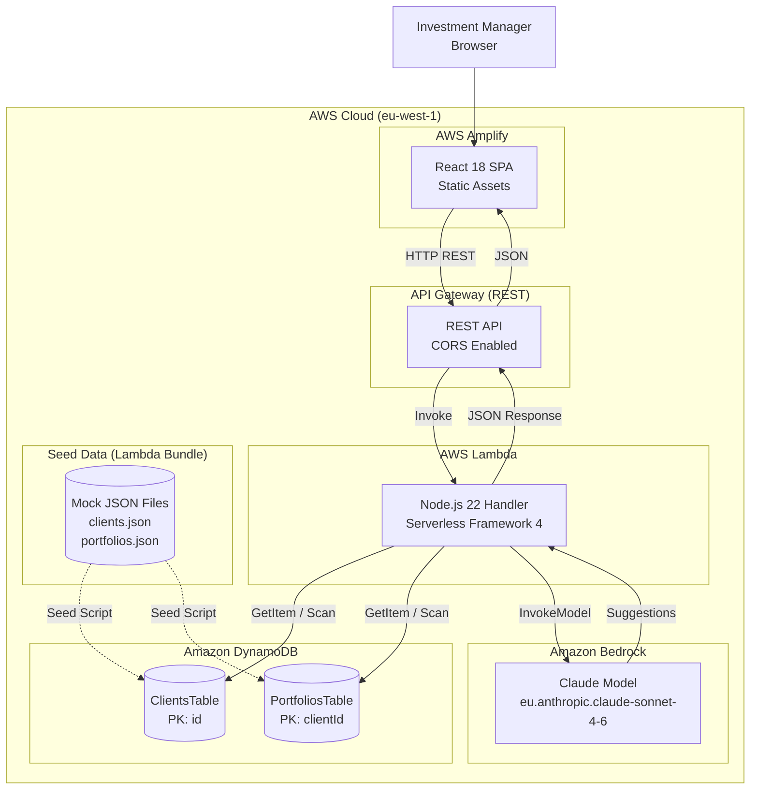
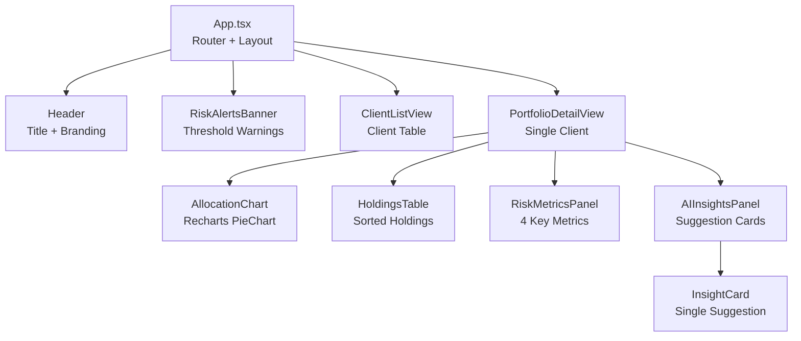

# Design Document: Client Portfolio Risk Dashboard

## Overview

The Client Portfolio Risk Dashboard is a single-page application (SPA) that provides Wealth Management investment managers with a unified view of client portfolios, risk metrics, and AI-generated rebalancing suggestions. The system follows a decoupled architecture with a React 18 frontend hosted on AWS Amplify communicating with AWS Lambda functions via API Gateway REST endpoints. Amazon Bedrock (Claude) provides AI-powered portfolio analysis.

The application is structured as a monorepo subfolder (`client-portfolio-risk-dashboard/`) containing both frontend and backend code in plain JavaScript (no TypeScript). Client and portfolio data is stored in DynamoDB using a single-table design. The frontend renders client lists, portfolio allocation charts (pie chart via Recharts), holdings tables, risk metrics panels, and AI insight cards. The backend reads from DynamoDB and integrates with Bedrock for generating rebalancing suggestions.

### Key Design Decisions

1. **Recharts over Chart.js** — Replaced by Cloudscape's built-in `PieChart` component which provides consistent styling with the rest of the UI. No additional charting library needed.
2. **Serverless Framework 4** — Provides infrastructure-as-code for Lambda + API Gateway with minimal configuration, supports Node.js 22 runtime, and handles CORS configuration declaratively.
3. **DynamoDB for structured data persistence** — Client and portfolio data is stored in DynamoDB tables, providing consistent low-latency reads, automatic scaling, and a production-grade data layer. Mock JSON files are retained as seed data for initial table population.
4. **Separate Lambda functions per endpoint** — Each API route gets its own Lambda function defined in serverless.yml. This keeps handlers small, enables per-function IAM scoping, and avoids a monolithic router. Serverless Framework 4 handles API Gateway creation implicitly from the `httpApi` events — no raw CloudFormation needed.

## Architecture



### DynamoDB Table Design

| Table | Partition Key | Attributes | Capacity |
|-------|--------------|------------|----------|
| `ClientsTable` | `id` (String) | name, portfolioValue, riskProfile, lastReviewDate, investmentManager | On-demand (PAY_PER_REQUEST) |
| `PortfoliosTable` | `clientId` (String) | allocation, holdings, riskMetrics | On-demand (PAY_PER_REQUEST) |

On-demand capacity is chosen for the demo to avoid provisioned throughput configuration while supporting unpredictable demo traffic patterns. Both tables use simple primary keys since access patterns are single-item lookups by ID and full table scans (5 items).

### Data Flow

1. **Client List**: Browser → Amplify (static) → API Gateway GET /clients → Lambda scans ClientsTable → JSON response
2. **Portfolio Detail**: Browser → API Gateway GET /clients/{id}/portfolio → Lambda GetItem from PortfoliosTable → JSON response
3. **AI Insights**: Browser → API Gateway POST /clients/{id}/insights → Lambda constructs prompt from portfolio data → Bedrock InvokeModel → Lambda formats response → JSON response
4. **Risk Alerts**: Computed client-side from portfolio data already fetched; no additional API call needed
5. **Data Seeding**: Seed script reads mock JSON files → BatchWriteItem to ClientsTable and PortfoliosTable (run once during initial setup or deployment)

## Components and Interfaces

### Frontend Component Tree



### React Components (Cloudscape Design System)

The frontend uses `@cloudscape-design/components` for all UI elements, providing a professional AWS-style look and feel with built-in accessibility, responsive behaviour, and consistent theming.

| Component             | Cloudscape Components Used                                          | Responsibility                                         |
| -----------------------| ---------------------------------------------------------------------| --------------------------------------------------------|
| `App`                 | `AppLayout`, `TopNavigation`                                        | Top-level layout shell, navigation, global state       |
| `Header`              | `TopNavigation`                                                     | App title, branding, navigation                        |
| `RiskAlertsBanner`    | `Flashbar`                                                          | Renders warning banners for threshold breaches         |
| `ClientListView`      | `Table`, `Header`, `Box`                                            | Tabular client list with click navigation              |
| `PortfolioDetailView` | `ContentLayout`, `Container`, `SpaceBetween`, `BreadcrumbGroup`     | Orchestrates portfolio sub-components, fetches data    |
| `AllocationChart`     | `PieChart`, `Container`, `Header`                                   | Cloudscape PieChart with percentage labels             |
| `HoldingsTable`       | `Table`, `Header`, `StatusIndicator`                                | Sorted table with colour-coded change indicators       |
| `RiskMetricsPanel`    | `ColumnLayout`, `Container`, `Box`, `Header`                        | Four metric cards in a grid                            |
| `AIInsightsPanel`     | `Container`, `Button`, `Spinner`, `Alert`, `SpaceBetween`           | Manages insight fetching, loading state, error display |
| `InsightCard`         | `Container`, `Header`, `Box`                                        | Single styled suggestion card                          |

### Frontend State Management

Simple `useState` + `useEffect` hooks (no Redux needed for this scope):

- `clients: Client[]` — fetched once on app mount
- `selectedClientId: string | null` — drives view switching
- `portfolio: Portfolio | null` — fetched when client selected
- `insights: string[] | null` — fetched on button click
- `insightsLoading: boolean` — loading state for Bedrock call
- `insightsError: string | null` — error state for Bedrock call
- `alerts: RiskAlert[]` — computed from all portfolio data

### Backend API Interface

#### GET /clients

**Response 200:**
```json
[
  {
    "id": "CLT001",
    "name": "Smith Family Trust",
    "portfolioValue": 2450000,
    "riskProfile": "Balanced",
    "lastReviewDate": "2026-03-15",
    "investmentManager": "James Richardson"
  }
]
```

#### GET /clients/{id}

**Response 200:**
```json
{
  "id": "CLT001",
  "name": "Smith Family Trust",
  "portfolioValue": 2450000,
  "riskProfile": "Balanced",
  "lastReviewDate": "2026-03-15",
  "investmentManager": "James Richardson"
}
```

**Response 404:**
```json
{ "error": "Client not found", "clientId": "CLT999" }
```

#### GET /clients/{id}/portfolio

**Response 200:**
```json
{
  "clientId": "CLT001",
  "allocation": {
    "ukEquities": 38,
    "internationalEquities": 25,
    "fixedIncome": 20,
    "alternatives": 10,
    "cash": 7
  },
  "holdings": [
    { "name": "Shell PLC", "sector": "Energy", "value": 245000, "weight": 10.0, "change1M": 2.3 }
  ],
  "riskMetrics": {
    "volatility": 11.2,
    "sharpeRatio": 0.85,
    "maxDrawdown": -8.4,
    "betaFTSE100": 0.92
  }
}
```

#### POST /clients/{id}/insights

**Request Body:**
```json
{
  "allocation": { "ukEquities": 38, "internationalEquities": 25, "fixedIncome": 20, "alternatives": 10, "cash": 7 },
  "riskProfile": "Balanced",
  "riskMetrics": { "volatility": 11.2, "sharpeRatio": 0.85, "maxDrawdown": -8.4, "betaFTSE100": 0.92 }
}
```

**Response 200:**
```json
{
  "suggestions": [
    "Portfolio is overweight UK equities (38%) vs target (30%). Consider reducing by 8% and reallocating to International Fixed Income for diversification.",
    "Cash allocation (7%) exceeds target (5%). With current gilt yields at 4.2%, consider short-duration gilts.",
    "Sharpe ratio (0.85) is below optimal. Consider increasing allocation to low-correlation alternatives."
  ]
}
```

**Response 500:**
```json
{ "error": "Failed to generate insights. Please try again." }
```

### Lambda Handler Design

Separate handler functions, one per endpoint. Each is defined as its own function in `serverless.yml`:

```yaml
# serverless.yml (Serverless Framework 4 — clean syntax, no CloudFormation)
service: portfolio-risk-dashboard
provider:
  name: aws
  runtime: nodejs22.x
  region: eu-west-1
  environment:
    TABLE_NAME: ${self:service}-${sls:stage}
  iam:
    role:
      statements:
        - Effect: Allow
          Action:
            - dynamodb:GetItem
            - dynamodb:Scan
            - dynamodb:Query
          Resource: !GetAtt ClientPortfoliosTable.Arn
        - Effect: Allow
          Action:
            - bedrock:InvokeModel
          Resource: "arn:aws:bedrock:eu-west-1:*:model/eu.anthropic.claude-sonnet-4-6"

functions:
  listClients:
    handler: src/handlers/listClients.handler
    events:
      - httpApi:
          path: /clients
          method: get

  getClient:
    handler: src/handlers/getClient.handler
    events:
      - httpApi:
          path: /clients/{id}
          method: get

  getPortfolio:
    handler: src/handlers/getPortfolio.handler
    events:
      - httpApi:
          path: /clients/{id}/portfolio
          method: get

  generateInsights:
    handler: src/handlers/generateInsights.handler
    timeout: 30
    events:
      - httpApi:
          path: /clients/{id}/insights
          method: post

resources:
  Resources:
    ClientPortfoliosTable:
      Type: AWS::DynamoDB::Table
      Properties:
        TableName: ${self:service}-${sls:stage}
        BillingMode: PAY_PER_REQUEST
        AttributeDefinitions:
          - AttributeName: PK
            AttributeType: S
          - AttributeName: SK
            AttributeType: S
        KeySchema:
          - AttributeName: PK
            KeyType: HASH
          - AttributeName: SK
            KeyType: RANGE
```

Each handler file exports a single `handler` function:

```javascript
// src/handlers/listClients.js
const { getAllClients } = require('../services/dynamodb');

module.exports.handler = async (event) => {
  const clients = await getAllClients();
  return { statusCode: 200, body: JSON.stringify(clients) };
};
```

### DynamoDB Data Access Layer

The Lambda function uses the AWS SDK v3 `@aws-sdk/lib-dynamodb` (Document Client) for simplified DynamoDB operations:

```
DynamoDBDocumentClient.from(new DynamoDBClient({ region: "eu-west-1" }))
  → ScanCommand({ TableName: "ClientsTable" })           // listClients
  → GetCommand({ TableName: "ClientsTable", Key: { id } })  // getClient
  → GetCommand({ TableName: "PortfoliosTable", Key: { clientId } })  // getPortfolio
```

Table names are passed via Lambda environment variables (`CLIENTS_TABLE`, `PORTFOLIOS_TABLE`) defined in `serverless.yml`.

### Bedrock Integration

The Lambda function calls Amazon Bedrock using the AWS SDK v3 `@aws-sdk/client-bedrock-runtime`. Authentication uses the Lambda execution role's instance profile (no explicit credentials needed):

```
BedrockRuntimeClient({ region: "eu-west-1" })
  → InvokeModelCommand({
      modelId: "eu.anthropic.claude-sonnet-4-6",
      contentType: "application/json",
      body: JSON.stringify({
        anthropic_version: "bedrock-2023-05-31",
        max_tokens: 4096,
        messages: [{ role: "user", content: prompt }]
      })
    })
```

Note: The SDK automatically picks up credentials from the Lambda execution role's instance profile. No API keys or explicit credential configuration required.

The prompt template includes:
- Client's current allocation percentages
- Risk profile (Conservative/Balanced/Growth)
- Current risk metrics
- Target allocation ranges per risk profile
- Instruction to return exactly 3-4 actionable suggestions with specific percentages

## Data Models

### Data Shapes (JSDoc)

```javascript
/**
 * @typedef {Object} Client
 * @property {string} id - e.g., "CLT001"
 * @property {string} name - e.g., "Smith Family Trust"
 * @property {number} portfolioValue - in GBP, e.g., 2450000
 * @property {"Conservative"|"Balanced"|"Growth"} riskProfile
 * @property {string} lastReviewDate - ISO date, e.g., "2026-03-15"
 * @property {string} investmentManager
 */

/**
 * @typedef {Object} Allocation
 * @property {number} ukEquities - percentage, e.g., 38
 * @property {number} internationalEquities - percentage, e.g., 25
 * @property {number} fixedIncome - percentage, e.g., 20
 * @property {number} alternatives - percentage, e.g., 10
 * @property {number} cash - percentage, e.g., 7
 */

/**
 * @typedef {Object} Holding
 * @property {string} name - e.g., "Shell PLC"
 * @property {string} sector - e.g., "Energy"
 * @property {number} value - GBP value, e.g., 245000
 * @property {number} weight - percentage, e.g., 10.0
 * @property {number} change1M - percentage change, e.g., 2.3 or -1.2
 */

/**
 * @typedef {Object} RiskMetrics
 * @property {number} volatility - annualised %, e.g., 11.2
 * @property {number} sharpeRatio - decimal, e.g., 0.85
 * @property {number} maxDrawdown - negative %, e.g., -8.4
 * @property {number} betaFTSE100 - decimal, e.g., 0.92
 */

/**
 * @typedef {Object} Portfolio
 * @property {string} clientId
 * @property {Allocation} allocation
 * @property {Holding[]} holdings
 * @property {RiskMetrics} riskMetrics
 */

/**
 * @typedef {Object} RiskAlert
 * @property {string} clientId
 * @property {string} clientName
 * @property {"equity_overweight"|"volatility_breach"} type
 * @property {string} message
 */

/**
 * @typedef {Object} InsightsRequest
 * @property {Allocation} allocation
 * @property {"Conservative"|"Balanced"|"Growth"} riskProfile
 * @property {RiskMetrics} riskMetrics
 */

/**
 * @typedef {Object} InsightsResponse
 * @property {string[]} suggestions
 */

/**
 * @typedef {Object} RiskThresholds
 * @property {number} maxEquityOverTarget - percentage points, e.g., 10
 * @property {{Conservative: number, Balanced: number, Growth: number}} volatilityTargets
 * @property {{Conservative: Allocation, Balanced: Allocation, Growth: Allocation}} targetAllocations
 */
```

### Project Folder Structure

```
client-portfolio-risk-dashboard/
├── frontend/
│   ├── public/
│   │   └── index.html
│   ├── src/
│   │   ├── components/
│   │   │   ├── Header.js
│   │   │   ├── RiskAlertsBanner.js
│   │   │   ├── ClientListView.js
│   │   │   ├── PortfolioDetailView.js
│   │   │   ├── AllocationChart.js
│   │   │   ├── HoldingsTable.js
│   │   │   ├── RiskMetricsPanel.js
│   │   │   ├── AIInsightsPanel.js
│   │   │   └── InsightCard.js
│   │   ├── utils/
│   │   │   ├── formatters.js
│   │   │   └── riskCalculations.js
│   │   ├── api/
│   │   │   └── client.js
│   │   ├── App.js
│   │   ├── App.css
│   │   ├── index.js
│   │   └── index.css
│   ├── package.json
│   ├── jsconfig.json
│   └── amplify.yml
├── backend/
│   ├── src/
│   │   ├── handlers/
│   │   │   ├── listClients.js
│   │   │   ├── getClient.js
│   │   │   ├── getPortfolio.js
│   │   │   └── generateInsights.js
│   │   ├── services/
│   │   │   ├── bedrock.js
│   │   │   └── dynamodb.js
│   │   └── data/
│   │       ├── clients.json
│   │       └── portfolios.json
│   ├── scripts/
│   │   └── seed.js
│   ├── serverless.yml
│   └── package.json
└── README.md
```

