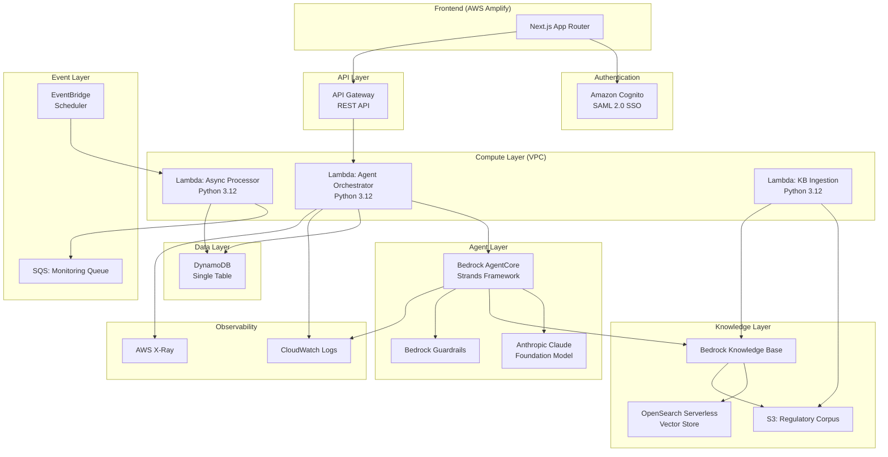
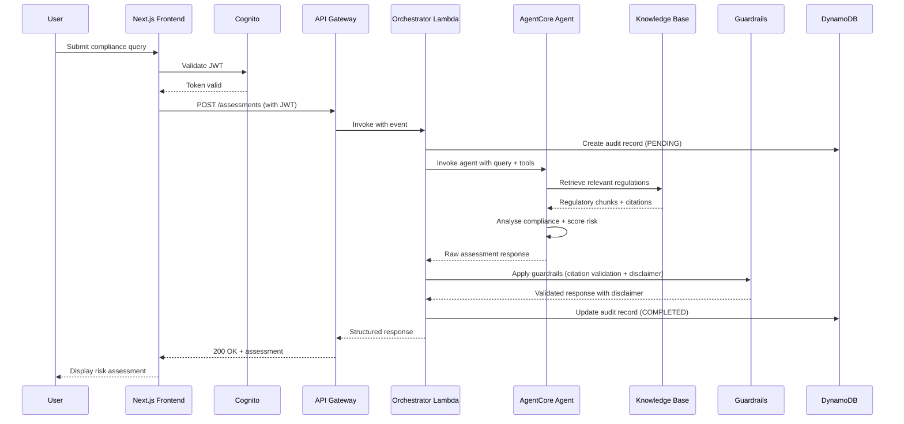

# Design Document: Consumer Regulatory Protection Agent

## Overview

This document describes the technical design for a Consumer Regulatory Protection Agent built on Amazon Bedrock AgentCore. The system provides multi-jurisdictional consumer protection compliance assessments for a global law firm's Consumer Markets practice. It uses RAG over a curated regulatory corpus to deliver preliminary risk assessments, jurisdiction-specific checklists, and structured escalation to human lawyers.

The architecture follows a serverless, event-driven pattern with clear separation between the agent orchestration layer (Bedrock AgentCore), the knowledge retrieval layer (Bedrock Knowledge Bases), the safety layer (Bedrock Guardrails), and the application layer (API Gateway + Lambda). The frontend is a Next.js application deployed on AWS Amplify, authenticated via Amazon Cognito with enterprise SSO federation.

### Key Design Decisions

1. **Code-based AgentCore agent using Strands framework** — Provides full control over orchestration logic, enabling custom tool routing for compliance analysis, checklist generation, and escalation workflows.
2. **Single DynamoDB table design** — All entities (conversations, audit records, user preferences, monitoring subscriptions) share one table with composite keys, reducing operational overhead and enabling transactional writes across entity types.
3. **Bedrock Guardrails as a post-processing layer** — Every agent response passes through Guardrails for citation validation and disclaimer injection before reaching the user.
4. **Separate Knowledge Base data sources per jurisdiction tier** — Enables independent update cadences and metadata-filtered retrieval scoped to user-selected jurisdictions.

## Architecture

### High-Level Architecture Diagram



### Request Flow



### Network Architecture

All Lambda functions execute within a VPC with private subnets. VPC endpoints are configured for:
- `com.amazonaws.{region}.bedrock-runtime` — Bedrock model invocation
- `com.amazonaws.{region}.bedrock-agent-runtime` — AgentCore and Knowledge Base retrieval
- `com.amazonaws.{region}.dynamodb` — DynamoDB access (Gateway endpoint)
- `com.amazonaws.{region}.s3` — S3 access for corpus (Gateway endpoint)
- `com.amazonaws.{region}.logs` — CloudWatch Logs

This ensures all traffic between Lambda and AWS services remains within the AWS network, satisfying the security requirement for no public internet traversal.

## Components and Interfaces

### 1. Agent Orchestrator Lambda

**Purpose:** Entry point for all compliance assessment requests. Manages the lifecycle of agent invocations, audit trail creation, and response post-processing.

**Interface:**
```python
# Handler signature
def handler(event: APIGatewayProxyEvent, context: LambdaContext) -> APIGatewayProxyResponse:
    ...

# Internal interface
class AgentOrchestrator:
    def invoke_compliance_assessment(self, query: ComplianceQuery) -> AssessmentResult: ...
    def invoke_checklist_generation(self, query: ChecklistQuery) -> ChecklistResult: ...
    def invoke_data_compliance(self, query: DataComplianceQuery) -> DataComplianceResult: ...
    def invoke_escalation(self, escalation: EscalationRequest) -> EscalationResult: ...
```

### 2. AgentCore Agent (Strands Framework)

**Purpose:** Core AI orchestration. Receives structured queries, selects appropriate tools, retrieves regulatory context from Knowledge Base, and produces compliance assessments.

**Tools registered with the agent:**
- `retrieve_regulations` — Queries Knowledge Base with jurisdiction and topic filters
- `score_risk` — Applies risk scoring logic based on regulation matches and severity
- `generate_checklist` — Produces structured checklist items from regulatory requirements
- `cross_reference_jurisdictions` — Identifies conflicts across multiple jurisdictions
- `check_vulnerable_consumer_rules` — Applies enhanced scrutiny for vulnerable consumer targeting
- `validate_substantiation` — Checks comparative claim substantiation requirements

**Interface:**
```python
class ComplianceAgent:
    def __init__(self, model_id: str, knowledge_base_id: str, guardrail_id: str): ...
    
    @tool
    def retrieve_regulations(self, jurisdictions: list[str], topic: str, query: str) -> list[RegulationChunk]: ...
    
    @tool
    def score_risk(self, concerns: list[ComplianceConcern], jurisdiction: str) -> RiskScore: ...
    
    @tool
    def generate_checklist(self, product_category: str, jurisdictions: list[str]) -> list[ChecklistItem]: ...
    
    @tool
    def cross_reference_jurisdictions(self, requirements: list[Requirement]) -> CrossReferenceResult: ...
```

### 3. Bedrock Knowledge Base

**Purpose:** Stores and retrieves regulatory documents using vector embeddings for semantic search.

**Configuration:**
- Embedding model: Amazon Titan Embeddings V2
- Vector store: OpenSearch Serverless
- Chunking strategy: Hierarchical chunking (parent: 1500 tokens, child: 300 tokens)
- Metadata filtering: jurisdiction, document_type, effective_date, sector

**Data Sources (S3 prefixes):**
```
s3://regulatory-corpus-{account-id}/
├── uk/
│   ├── consumer-rights-act-2015/
│   ├── cap-code/
│   ├── asa-rulings/
│   └── cma-guidance/
├── eu/
│   ├── omnibus-directive/
│   ├── digital-services-act/
│   └── consumer-protection-cooperation/
└── us/
    └── ftc-act-section-5/
```

### 4. Bedrock Guardrails

**Purpose:** Ensures all agent outputs include legal disclaimers, validates citations against the Knowledge Base, and prevents hallucinated legal references.

**Configuration:**
- Content filter: Block harmful content (HIGH threshold)
- Word filter: Block definitive legal conclusion phrases ("you must", "this is legal", "this is illegal")
- Contextual grounding: Enable grounding check with 0.7 threshold to prevent hallucinated citations
- Managed word list: Profanity filter enabled
- Custom response: Inject legal disclaimer prefix on every response

**Disclaimer text:**
> "DISCLAIMER: This analysis is a preliminary AI-generated assessment and does not constitute legal advice. It is intended to support, not replace, professional legal review. Please consult with a qualified lawyer before taking action based on this assessment."

### 5. Escalation Service

**Purpose:** Packages assessment context and creates matter intakes in the practice management system.

**Interface:**
```python
class EscalationService:
    def package_brief(self, assessment: AssessmentResult, query: ComplianceQuery) -> EscalationBrief: ...
    def create_matter_intake(self, brief: EscalationBrief) -> MatterIntakeResult: ...
    def get_escalation_status(self, matter_reference: str) -> EscalationStatus: ...
```

### 6. Monitoring Service

**Purpose:** Detects regulatory changes, generates impact summaries, and delivers alerts to subscribed users.

**Interface:**
```python
class MonitoringService:
    def check_regulatory_updates(self, jurisdiction: str) -> list[RegulatoryUpdate]: ...
    def generate_impact_summary(self, update: RegulatoryUpdate, user_profile: UserProfile) -> ImpactSummary: ...
    def categorise_urgency(self, update: RegulatoryUpdate) -> UrgencyLevel: ...
    def send_notification(self, user_id: str, summary: ImpactSummary) -> NotificationResult: ...
```

### 7. Frontend (Next.js App Router)

**Purpose:** Client-facing web application for submitting compliance queries, viewing assessments, managing preferences, and triggering escalations.

**Key routes:**
- `/` — Dashboard with recent assessments and alerts
- `/assess/campaign` — Marketing campaign compliance check
- `/assess/product` — Product launch checklist generator
- `/assess/data` — Consumer data collection compliance
- `/history` — Assessment history and audit trail
- `/settings` — Monitoring preferences and jurisdiction configuration
- `/escalation/[id]` — Escalation status and matter tracking

## Data Models

### DynamoDB Single-Table Design

**Table name:** `ConsumerRegulatoryAgent`
**Billing mode:** PAY_PER_REQUEST
**Encryption:** AWS KMS customer-managed key

| Access Pattern | PK | SK | GSI1PK | GSI1SK |
|---|---|---|---|---|
| Get assessment by ID | `ASSESSMENT#{assessmentId}` | `METADATA` | `USER#{userId}` | `ASSESSMENT#{timestamp}` |
| Get conversation messages | `CONVERSATION#{conversationId}` | `MSG#{timestamp}#{messageId}` | `USER#{userId}` | `CONVERSATION#{timestamp}` |
| Get user preferences | `USER#{userId}` | `PREFERENCES` | — | — |
| Get monitoring subscriptions | `USER#{userId}` | `MONITOR#{jurisdiction}` | `JURISDICTION#{jurisdiction}` | `USER#{userId}` |
| Get audit trail for user | `USER#{userId}` | `AUDIT#{timestamp}#{assessmentId}` | — | — |
| Get escalation by matter ref | `ESCALATION#{matterId}` | `METADATA` | `USER#{userId}` | `ESCALATION#{timestamp}` |
| Get alerts for user | `USER#{userId}` | `ALERT#{timestamp}#{alertId}` | `JURISDICTION#{jurisdiction}` | `ALERT#{timestamp}` |

**GSI1:** Enables querying assessments, conversations, and escalations by user in reverse chronological order.

### Core Data Entities

```python
from dataclasses import dataclass
from datetime import datetime
from enum import Enum
from typing import Optional

class RiskLevel(Enum):
    LOW = "Low"
    MEDIUM = "Medium"
    HIGH = "High"
    CRITICAL = "Critical"

class UrgencyLevel(Enum):
    IMMEDIATE_ACTION = "Immediate Action Required"
    UPCOMING_DEADLINE = "Upcoming Deadline"
    AWARENESS_ONLY = "Awareness Only"

class AssessmentType(Enum):
    CAMPAIGN_COMPLIANCE = "campaign_compliance"
    PRODUCT_CHECKLIST = "product_checklist"
    DATA_COMPLIANCE = "data_compliance"

@dataclass
class ComplianceQuery:
    query_id: str
    user_id: str
    organisation_id: str
    assessment_type: AssessmentType
    content: str  # Campaign copy, product description, or data collection description
    jurisdictions: list[str]
    product_category: Optional[str] = None
    target_demographics: Optional[list[str]] = None
    created_at: datetime = None

@dataclass
class ComplianceConcern:
    concern_id: str
    description: str
    regulation_reference: str
    regulation_title: str
    jurisdiction: str
    severity: str  # "low", "medium", "high", "critical"
    evidence_required: Optional[str] = None

@dataclass
class RiskAssessment:
    jurisdiction: str
    risk_level: RiskLevel
    concerns: list[ComplianceConcern]
    regulation_citations: list[str]
    recommended_actions: list[str]
    escalation_recommended: bool

@dataclass
class AssessmentResult:
    assessment_id: str
    query_id: str
    user_id: str
    assessment_type: AssessmentType
    risk_assessments: list[RiskAssessment]
    disclaimer: str
    overall_risk: RiskLevel
    created_at: datetime
    response_time_ms: int
    model_id: str
    knowledge_base_version: str

@dataclass
class ChecklistItem:
    item_id: str
    requirement_description: str
    source_regulation: str
    jurisdiction: str
    compliance_action: str
    sector_specific: bool
    conflicts_with: Optional[list[str]] = None

@dataclass
class ChecklistResult:
    checklist_id: str
    query_id: str
    product_category: str
    jurisdictions: list[str]
    items: list[ChecklistItem]
    cross_jurisdiction_conflicts: list[str]
    disclaimer: str
    created_at: datetime

@dataclass
class EscalationBrief:
    brief_id: str
    assessment_id: str
    original_query: ComplianceQuery
    ai_analysis: AssessmentResult
    regulation_references: list[str]
    risk_summary: str
    audit_trail: list[dict]
    created_at: datetime

@dataclass
class MatterIntakeResult:
    matter_reference: str
    status: str  # "created", "failed"
    expected_response_timeline: str
    error_message: Optional[str] = None

@dataclass
class UserProfile:
    user_id: str
    organisation_id: str
    email: str
    role: str
    permitted_jurisdictions: list[str]
    sector: str
    notification_preferences: dict
    monitoring_jurisdictions: list[str]

@dataclass
class RegulatoryUpdate:
    update_id: str
    jurisdiction: str
    document_title: str
    change_summary: str
    effective_date: Optional[datetime]
    compliance_deadline: Optional[datetime]
    urgency: UrgencyLevel
    affected_sectors: list[str]
    source_url: str
    detected_at: datetime

@dataclass
class AuditRecord:
    audit_id: str
    user_id: str
    organisation_id: str
    assessment_id: str
    query_type: AssessmentType
    jurisdictions: list[str]
    risk_levels: dict[str, RiskLevel]
    response_time_ms: int
    model_id: str
    timestamp: datetime
    ttl: int  # 7 years in epoch seconds
```

### Knowledge Base Document Metadata Schema

```json
{
  "metadataAttributes": {
    "jurisdiction": {
      "type": "STRING",
      "description": "Legal jurisdiction (UK, EU, US)"
    },
    "document_type": {
      "type": "STRING",
      "description": "Type: legislation, code, ruling, guidance"
    },
    "effective_date": {
      "type": "STRING",
      "description": "ISO 8601 date when document became effective"
    },
    "last_updated": {
      "type": "STRING",
      "description": "ISO 8601 date of last document update"
    },
    "sector": {
      "type": "STRING",
      "description": "Applicable sector (general, food, cosmetics, electronics, digital)"
    },
    "source_url": {
      "type": "STRING",
      "description": "Original source URL"
    },
    "version": {
      "type": "STRING",
      "description": "Document version identifier"
    }
  }
}
```

## API Design

### REST API Endpoints

| Method | Path | Description | Auth |
|--------|------|-------------|------|
| POST | `/v1/assessments/campaign` | Submit campaign compliance check | Required |
| POST | `/v1/assessments/product` | Submit product launch checklist | Required |
| POST | `/v1/assessments/data` | Submit data collection compliance check | Required |
| GET | `/v1/assessments/{id}` | Get assessment by ID | Required |
| GET | `/v1/assessments` | List user's assessments (paginated) | Required |
| POST | `/v1/escalations` | Create escalation from assessment | Required |
| GET | `/v1/escalations/{id}` | Get escalation status | Required |
| GET | `/v1/conversations/{id}` | Get conversation history | Required |
| POST | `/v1/conversations/{id}/messages` | Send follow-up message | Required |
| GET | `/v1/monitoring/alerts` | Get user's regulatory alerts | Required |
| PUT | `/v1/monitoring/preferences` | Update monitoring preferences | Required |
| GET | `/v1/health` | Health check (no auth) | None |

### Request/Response Examples

**POST /v1/assessments/campaign**
```json
{
  "campaign_copy": "Get 50% more value than Brand X! Our organic skincare...",
  "jurisdictions": ["UK", "EU"],
  "target_demographics": ["general_adult"],
  "product_category": "cosmetics",
  "conversation_id": "optional-existing-conversation-id"
}
```

**Response (200 OK):**
```json
{
  "assessment_id": "assess_abc123",
  "overall_risk": "High",
  "disclaimer": "DISCLAIMER: This analysis is a preliminary AI-generated assessment...",
  "risk_assessments": [
    {
      "jurisdiction": "UK",
      "risk_level": "High",
      "concerns": [
        {
          "description": "Comparative claim '50% more value than Brand X' requires substantiation evidence",
          "regulation_reference": "CAP Code Section 3.33",
          "regulation_title": "Substantiation of comparative claims",
          "severity": "high",
          "evidence_required": "Independent testing data comparing product value metrics"
        }
      ],
      "regulation_citations": ["CAP Code 3.33", "Consumer Rights Act 2015 s.12"],
      "recommended_actions": [
        "Obtain independent substantiation evidence for comparative claim",
        "Review 'organic' claim against EU Cosmetics Regulation labelling requirements"
      ],
      "escalation_recommended": true
    }
  ],
  "conversation_id": "conv_xyz789",
  "response_time_ms": 4200,
  "created_at": "2025-01-15T10:30:00Z"
}
```


## Correctness Properties

*A property is a characteristic or behavior that should hold true across all valid executions of a system — essentially, a formal statement about what the system should do. Properties serve as the bridge between human-readable specifications and machine-verifiable correctness guarantees.*

### Property 1: Risk scoring correctness

*For any* list of ComplianceConcern objects with defined severities and a target jurisdiction, the Risk_Scorer SHALL produce a risk level (Low, Medium, High, or Critical) that is consistent with the defined scoring rules, and the assessment SHALL include at least one regulation reference for each identified concern.

**Validates: Requirements 1.4**

### Property 2: Assessment output structural completeness

*For any* valid ComplianceQuery with non-empty campaign copy and at least one jurisdiction, the returned AssessmentResult SHALL contain: a risk level for every requested jurisdiction, at least one regulation citation per jurisdiction assessed, a non-empty list of compliance concerns or an explicit "no concerns" indicator, and recommended next steps.

**Validates: Requirements 1.5**

### Property 3: Input validation rejects invalid queries

*For any* ComplianceQuery where campaign_copy is empty or consists entirely of whitespace, OR where the jurisdictions list is empty, the system SHALL return a validation error that identifies the specific missing required fields, and no assessment processing SHALL occur.

**Validates: Requirements 1.6**

### Property 4: Cross-jurisdiction conflict detection

*For any* set of regulatory requirements drawn from two or more jurisdictions where a known conflict exists (e.g., one jurisdiction requires disclosure that another prohibits), the cross_reference_jurisdictions function SHALL identify and report the conflict with references to both conflicting requirements.

**Validates: Requirements 2.4**

### Property 5: Checklist item structural completeness

*For any* ChecklistItem produced by the Checklist_Generator, the item SHALL contain all four required fields: requirement_description (non-empty string), source_regulation (valid regulation reference), jurisdiction (valid jurisdiction code), and compliance_action (non-empty string describing the action needed).

**Validates: Requirements 2.5**

### Property 6: Missing consent mechanism detection

*For any* data collection compliance query that does not describe a consent mechanism, the system SHALL flag the absence as a gap and return a non-empty list of consent requirements applicable under both consumer protection and data privacy regulations for each selected jurisdiction.

**Validates: Requirements 3.5**

### Property 7: Urgency categorisation follows deadline rules

*For any* RegulatoryUpdate with a compliance_deadline date, the categorise_urgency function SHALL return "Immediate Action Required" if the deadline is within 30 days of detection, "Upcoming Deadline" if within 90 days, and "Awareness Only" otherwise. Updates with no compliance deadline SHALL be categorised as "Awareness Only".

**Validates: Requirements 4.2**

### Property 8: User preferences round-trip

*For any* valid UserProfile with monitoring preferences (sector, operating jurisdictions, notification channel), storing the preferences and then retrieving them SHALL return an equivalent configuration with all fields preserved.

**Validates: Requirements 4.4**

### Property 9: Escalation option presence

*For any* AssessmentResult where at least one jurisdiction has a risk level of "High" or "Critical", the response SHALL include an escalation option. For any AssessmentResult where all jurisdictions have risk levels of "Low" or "Medium", the escalation option SHALL NOT be automatically presented.

**Validates: Requirements 5.1**

### Property 10: Escalation brief completeness

*For any* escalation triggered from a valid AssessmentResult, the resulting EscalationBrief SHALL contain: the original ComplianceQuery (complete), the full AI-generated AssessmentResult, all regulation references cited in the assessment, the risk summary, and a non-empty audit trail.

**Validates: Requirements 5.2, 5.6**

### Property 11: Jurisdiction-based access control enforcement

*For any* authenticated user with a defined set of permitted_jurisdictions, access to assessment functionality for a given jurisdiction SHALL be granted if and only if that jurisdiction is in the user's permitted_jurisdictions list. Requests for non-permitted jurisdictions SHALL be rejected with an authorisation error.

**Validates: Requirements 6.3**

### Property 12: Legal disclaimer injection

*For any* response produced by the Agent (assessment, checklist, data compliance, or escalation confirmation), the response SHALL contain the legal disclaimer stating the analysis is preliminary and does not constitute legal advice.

**Validates: Requirements 7.1**

### Property 13: Citation integrity

*For any* agent response, all regulation citations included in the final output SHALL be verifiable against the Knowledge_Base. Any citation generated by the model that is NOT present in the Knowledge_Base SHALL be removed from the final output, and the response SHALL include a flag indicating the gap to the user.

**Validates: Requirements 7.2, 7.3**

### Property 14: Definitive legal conclusion prevention

*For any* agent response text, the output SHALL NOT contain definitive legal conclusions (phrases such as "you must", "this is legal", "this is illegal", "you are required to", "this violates the law"). All outputs SHALL be framed as preliminary assessments.

**Validates: Requirements 7.4**

### Property 15: Audit record persistence completeness

*For any* compliance query processed by the Agent, a corresponding audit record SHALL exist in DynamoDB containing: the full query, the full response, the risk assessment per jurisdiction, the timestamp, the user ID, and the model ID used. The record SHALL be immutable (no updates after creation).

**Validates: Requirements 8.1**

### Property 16: Conversation history ordering

*For any* conversation with multiple messages, retrieving the conversation history SHALL return messages in chronological order (oldest first), and each message SHALL contain the original content, sender identifier, and timestamp.

**Validates: Requirements 8.2**

### Property 17: Assessment history reverse chronological ordering

*For any* user with multiple assessments, retrieving assessment history SHALL return assessments in reverse chronological order (newest first), and the ordering SHALL be stable (repeated retrievals produce the same order).

**Validates: Requirements 8.3**

### Property 18: Error response user-friendliness

*For any* error that occurs during processing, the user-facing response SHALL contain a friendly error message without stack traces, internal service names, or implementation details. The corresponding log entry SHALL contain the full error context including request ID, component name, error type, and stack trace.

**Validates: Requirements 9.4**

### Property 19: Document metadata completeness on ingestion

*For any* document ingested into the Knowledge_Base, the index entry SHALL contain all required metadata fields: source_url, jurisdiction, document_type, effective_date, and last_updated. No metadata field SHALL be null or empty.

**Validates: Requirements 10.2**

### Property 20: Assessment citations include document version

*For any* regulation citation in an AssessmentResult, the citation SHALL include or be traceable to the specific document version that was current in the Knowledge_Base at the time of analysis.

**Validates: Requirements 10.4**

## Error Handling

### Error Categories and Responses

| Error Category | HTTP Status | User Message | Internal Action |
|---|---|---|---|
| Validation Error (empty input, missing jurisdiction) | 400 | "Please provide [missing field] to proceed with the assessment." | Log validation failure with request details |
| Authentication Failure | 401 | "Your session has expired. Please sign in again." | Log auth failure, increment failed attempt counter |
| Authorisation Error (jurisdiction not permitted) | 403 | "Your organisation does not have access to [jurisdiction] assessments." | Log access attempt for security audit |
| Unsupported Jurisdiction | 422 | "Assessment for [jurisdiction] is not currently available. Supported jurisdictions: [list]." | Log unsupported jurisdiction request |
| Agent Timeout (>30s) | 504 | "The assessment is taking longer than expected. Please try again or simplify your query." | Emit latency alarm, log timeout with query details |
| Knowledge Base Retrieval Failure | 502 | "We're experiencing a temporary issue retrieving regulatory data. Please try again shortly." | Retry with exponential backoff (3 attempts), then fail |
| Bedrock Model Error | 502 | "The compliance engine is temporarily unavailable. Please try again in a few minutes." | Log model error, emit CloudWatch alarm |
| DynamoDB Write Failure | 500 | "Your assessment was completed but we couldn't save it. Please contact support with request ID: [id]." | Retry write, queue for async retry if persistent |
| Escalation Service Failure | 200 (partial) | "Escalation could not be completed. Your brief has been saved. Alternative contact: [details]." | Retain brief in DDB, alert operations team |
| Ingestion Failure | N/A (async) | N/A | Log failure with source ID and reason, alert knowledge manager via SNS |

### Retry Strategy

```python
RETRY_CONFIG = {
    "bedrock_invoke": {
        "max_attempts": 3,
        "backoff_base": 1.0,  # seconds
        "backoff_multiplier": 2.0,
        "retryable_errors": ["ThrottlingException", "ServiceUnavailableException"]
    },
    "dynamodb_write": {
        "max_attempts": 3,
        "backoff_base": 0.5,
        "backoff_multiplier": 2.0,
        "retryable_errors": ["ProvisionedThroughputExceededException", "InternalServerError"]
    },
    "knowledge_base_retrieve": {
        "max_attempts": 3,
        "backoff_base": 1.0,
        "backoff_multiplier": 2.0,
        "retryable_errors": ["ThrottlingException", "ServiceUnavailableException"]
    },
    "escalation_service": {
        "max_attempts": 2,
        "backoff_base": 2.0,
        "backoff_multiplier": 2.0,
        "retryable_errors": ["ConnectionError", "TimeoutError"]
    }
}
```

### Circuit Breaker Pattern

For the escalation service (external practice management system), implement a circuit breaker:
- **Closed** (normal): Requests pass through
- **Open** (after 5 consecutive failures in 60s): Requests fail fast, brief is retained, user offered alternatives
- **Half-open** (after 30s cooldown): Single test request; success closes circuit, failure re-opens

### Graceful Degradation

1. **Knowledge Base unavailable**: Return cached assessment templates with disclaimer that real-time regulatory data is unavailable
2. **Guardrails unavailable**: Block all responses (fail closed) — never return unvalidated legal content
3. **DynamoDB unavailable**: Complete assessment but queue audit record for async write via SQS dead-letter queue
4. **Monitoring service failure**: Queue missed checks for retry; do not lose regulatory update events

## Testing Strategy

### Unit Tests (pytest)

Unit tests cover pure logic components with specific examples and edge cases:

- **Risk scoring logic**: Verify correct risk level assignment for known concern combinations
- **Input validation**: Test boundary conditions (empty strings, whitespace, null values, oversized inputs)
- **Urgency categorisation**: Test exact boundary dates (day 30, day 31, day 89, day 90, day 91)
- **Access control logic**: Test permitted/denied jurisdiction combinations
- **Citation validation**: Test known valid and invalid citation formats
- **Error message formatting**: Verify user-friendly messages for each error type
- **DynamoDB key construction**: Verify composite key generation for all entity types
- **Checklist item structure**: Verify all required fields are populated

### Property-Based Tests (Hypothesis)

Property-based tests validate universal correctness properties using the [Hypothesis](https://hypothesis.readthedocs.io/) library for Python. Each test runs a minimum of 100 iterations with randomly generated inputs.

**Configuration:**
```python
from hypothesis import settings, given, strategies as st

@settings(max_examples=100, deadline=None)
```

**Properties to implement:**

| Property | Test File | Generator Strategy |
|---|---|---|
| Property 1: Risk scoring | `test_risk_scorer_properties.py` | Random lists of ComplianceConcern with varying severities |
| Property 3: Input validation | `test_validation_properties.py` | Random strings (empty, whitespace, valid), random jurisdiction lists |
| Property 5: Checklist structure | `test_checklist_properties.py` | Random ChecklistItem instances |
| Property 7: Urgency categorisation | `test_monitoring_properties.py` | Random dates relative to "today" |
| Property 8: Preferences round-trip | `test_persistence_properties.py` | Random UserProfile configurations |
| Property 9: Escalation trigger | `test_escalation_properties.py` | Random AssessmentResults with varying risk levels |
| Property 11: Access control | `test_auth_properties.py` | Random user profiles and jurisdiction access attempts |
| Property 12: Disclaimer injection | `test_guardrails_properties.py` | Random response texts |
| Property 13: Citation integrity | `test_citation_properties.py` | Random citation sets (mix of valid/invalid) |
| Property 14: Definitive conclusion prevention | `test_guardrails_properties.py` | Random response texts with/without definitive phrases |
| Property 16: Conversation ordering | `test_persistence_properties.py` | Random message sequences with timestamps |
| Property 17: History ordering | `test_persistence_properties.py` | Random assessment sets with timestamps |
| Property 18: Error user-friendliness | `test_error_handling_properties.py` | Random error types and contexts |

**Tag format for each test:**
```python
# Feature: consumer-regulatory-protection-agent, Property 7: Urgency categorisation follows deadline rules
```

### Integration Tests

Integration tests verify end-to-end behavior against real AWS services (Bedrock, DynamoDB, Knowledge Base):

- Campaign compliance assessment with real regulatory corpus retrieval
- Product checklist generation with sector-specific content
- Escalation workflow with mock practice management system
- Knowledge Base ingestion and retrieval cycle
- Guardrails citation validation with real Knowledge Base
- Authentication flow with Cognito test user pool

### End-to-End Tests (Playwright)

E2E tests verify the complete user journey through the Next.js frontend:

- Login via SSO → Submit campaign → View assessment → Trigger escalation
- Product checklist generation → Download checklist
- Monitoring preferences configuration → Alert display
- Assessment history browsing and filtering
- Error state handling (timeout, service unavailable)

### CDK Assertion Tests

Infrastructure tests verify CDK synthesizes correct CloudFormation:

- All expected resources present (Lambda, API Gateway, DynamoDB, Cognito, VPC endpoints)
- Lambda runtime is Python 3.12
- KMS encryption configured on DynamoDB and S3
- VPC endpoints for Bedrock services
- IAM policies follow least-privilege
- Stack outputs include API URL, Cognito domain, CloudFront URL
