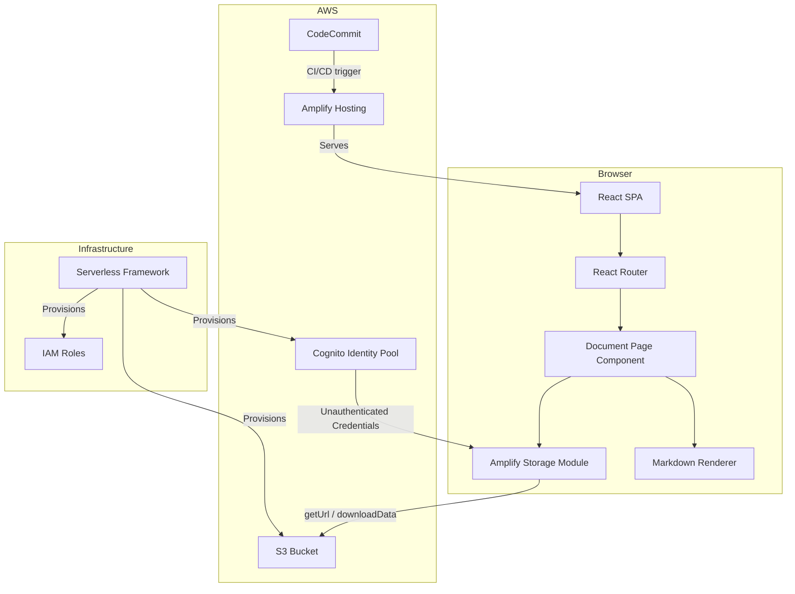

# Design Document: Markdown Document Viewer

## Overview

This design describes a React SPA that fetches markdown files from S3 and renders them as styled HTML pages. The application uses AWS Amplify V6 for S3 access (via Cognito Identity Pool unauthenticated credentials) and client-side routing to map URL paths directly to S3 object keys. Backend infrastructure (S3 bucket, Cognito Identity Pool, IAM roles) is managed via Serverless Framework. The app is hosted on Amplify Hosting at `docs.example.com`, connected to a CodeCommit repository for CI/CD.

Key design decisions:
- **No backend API**: Amplify Storage reads directly from S3, keeping the architecture simple and serverless.
- **Client-side routing**: React Router maps URL paths to S3 keys (e.g., `/guides/setup` → `guides/setup.md`).
- **Unauthenticated access**: Cognito Identity Pool provides guest credentials for public read-only S3 access.
- **JavaScript only**: No TypeScript. All files use kebab-case naming.

## Architecture



### Request Flow

1. User navigates to `docs.example.com/my-document`
2. Amplify Hosting serves `index.html` (all routes rewrite to index.html)
3. React Router matches the path `/my-document`
4. Document page component extracts the path and calls Amplify Storage to download `my-document.md` from S3
5. Raw markdown content is passed to the Markdown Renderer
6. Rendered HTML is displayed in a responsive layout

## Components and Interfaces

### 1. App Entry Point (`src/index.js`)

Initializes the React app and configures Amplify V6.

```javascript
// Amplify.configure() called with S3 bucket, region, and Identity Pool settings
// Renders <App /> into the DOM
```

### 2. Amplify Configuration (`src/amplify-config.js`)

Exports the Amplify V6 configuration object.

```javascript
const amplifyConfig = {
  Storage: {
    S3: {
      bucket: '<S3_BUCKET_NAME>',
      region: 'eu-west-1',
    }
  },
  Auth: {
    Cognito: {
      identityPoolId: '<IDENTITY_POOL_ID>',
      allowGuestAccess: true,
    }
  }
};
```

### 3. Router (`src/app.js`)

Top-level component with React Router configuration.

```javascript
// Routes:
//   "/" → <LandingPage />
//   "/*" → <DocumentPage />  (catch-all for document paths)
```

Uses `BrowserRouter` from `react-router-dom`. The catch-all route passes the full URL path to `DocumentPage`.

### 4. Document Page (`src/pages/document-page.js`)

Responsible for:
- Extracting the document path from the URL using `useParams()` or `useLocation()`
- Calling the document service to fetch markdown content
- Managing loading, error, and success states
- Rendering the markdown content via the Markdown Renderer
- Providing a retry button on error

```javascript
// Interface:
// Props: none (reads path from router)
// State: { content: string | null, loading: boolean, error: Error | null }
```

### 5. Landing Page (`src/pages/landing-page.js`)

Simple default page shown at the root route (`/`). Displays a welcome message or site title.

### 6. Document Service (`src/services/document-service.js`)

Encapsulates S3 document retrieval logic using Amplify V6 Storage.

```javascript
/**
 * Fetches a markdown document from S3.
 * @param {string} path - The document path (e.g., "my-document" or "guides/setup")
 * @returns {Promise<string>} - The raw markdown content
 * @throws {DocumentNotFoundError} - If the document doesn't exist in S3
 * @throws {NetworkError} - If S3 is unreachable
 */
async function fetchDocument(path) {
  // Constructs S3 key: `${path}.md`
  // Uses Amplify Storage downloadData() to fetch the file
  // Converts the response body to text
  // Returns the markdown string
}
```

### 7. Markdown Renderer (`src/components/markdown-renderer.js`)

Renders raw markdown as styled HTML.

- Uses `react-markdown` for markdown-to-HTML conversion
- Uses `remark-gfm` plugin for GitHub Flavored Markdown (tables, strikethrough, etc.)
- Uses `react-syntax-highlighter` with a light theme for fenced code block syntax highlighting

```javascript
// Interface:
// Props: { content: string }
// Renders: styled HTML from markdown
```

### 8. Error Boundary (`src/components/error-boundary.js`)

A React class component that catches unhandled errors in the component tree and displays a user-friendly error page.

```javascript
// Interface:
// Props: { children: ReactNode }
// State: { hasError: boolean, error: Error | null }
```

### 9. Loading Indicator (`src/components/loading-indicator.js`)

A simple spinner or skeleton component displayed while documents are being fetched.

### 10. Error Display (`src/components/error-display.js`)

Displays error messages with an optional retry button.

```javascript
// Interface:
// Props: { message: string, onRetry?: function }
```

## Data Models

### Amplify Configuration Object

```javascript
{
  Storage: {
    S3: {
      bucket: string,    // S3 bucket name
      region: string,    // AWS region (e.g., "eu-west-1")
    }
  },
  Auth: {
    Cognito: {
      identityPoolId: string,  // Cognito Identity Pool ID
      allowGuestAccess: true,  // Enable unauthenticated access
    }
  }
}
```

### Document Page State

```javascript
{
  content: string | null,  // Raw markdown content, null before fetch
  loading: boolean,        // True while fetching from S3
  error: {
    type: 'not-found' | 'network' | 'unknown',
    message: string,
  } | null
}
```

### Route-to-S3 Key Mapping

| URL Path | S3 Object Key |
|---|---|
| `/my-document` | `my-document.md` |
| `/guides/setup` | `guides/setup.md` |
| `/` | (landing page, no S3 fetch) |

### Serverless Framework Resources

```yaml
resources:
  Resources:
    DocumentBucket:
      Type: AWS::S3::Bucket
      Properties:
        BucketName: <bucket-name>
        CorsConfiguration:
          CorsRules:
            - AllowedOrigins: ['https://docs.example.com']
              AllowedMethods: [GET]
              AllowedHeaders: ['*']

    CognitoIdentityPool:
      Type: AWS::Cognito::IdentityPool
      Properties:
        AllowUnauthenticatedIdentities: true

    UnauthenticatedRole:
      Type: AWS::IAM::Role
      Properties:
        AssumeRolePolicyDocument: # Cognito federated identity trust
        Policies:
          - PolicyName: S3ReadAccess
            PolicyDocument:
              Statement:
                - Effect: Allow
                  Action: ['s3:GetObject']
                  Resource: 'arn:aws:s3:::<bucket-name>/*'
```


## Correctness Properties

*A property is a characteristic or behavior that should hold true across all valid executions of a system — essentially, a formal statement about what the system should do. Properties serve as the bridge between human-readable specifications and machine-verifiable correctness guarantees.*

### Property 1: Route-to-S3 key mapping

*For any* valid URL path string (single segment or nested segments), converting it to an S3 object key should produce the original path with `.md` appended, and converting the S3 key back (stripping `.md`) should return the original URL path.

**Validates: Requirements 2.1, 2.2, 3.1**

### Property 2: Markdown rendering robustness

*For any* arbitrary string (valid markdown, malformed markdown, or random text), passing it to the Markdown Renderer should produce a non-empty HTML string output without throwing an error.

**Validates: Requirements 4.1, 4.6**

### Property 3: Syntax highlighting applied to fenced code blocks

*For any* fenced code block with a language identifier (e.g., ` ```javascript ... ``` `), the Markdown Renderer output should contain syntax highlighting markup (e.g., `<code>` elements with `class` or `style` attributes indicating language-specific tokens).

**Validates: Requirements 4.4**

## Error Handling

### Error Categories

| Error Type | Trigger | User-Facing Behavior |
|---|---|---|
| Config Error | Missing/invalid Amplify config | Descriptive error message on app load (Req 1.2) |
| Document Not Found | S3 returns 404 / NoSuchKey | "Document not found" message (Req 2.4, 3.5) |
| Network Error | S3 unreachable, timeout | Error message + retry button (Req 3.4, 5.3, 5.4) |
| Unhandled Error | Unexpected JS exception | Error boundary catches and shows error page (Req 5.1) |

### Error Boundary Strategy

- A top-level `ErrorBoundary` class component wraps the entire app.
- It catches errors from any child component via `componentDidCatch`.
- Renders a user-friendly error page with a "reload" option.

### Document Fetch Error Handling

In `document-service.js`:
- Catch S3 `NoSuchKey` or 404 responses → throw a `DocumentNotFoundError`
- Catch network/timeout errors → throw a `NetworkError`
- All other errors → re-throw as generic errors

In `document-page.js`:
- `DocumentNotFoundError` → render "document not found" message
- `NetworkError` → render error message with a retry button that re-invokes `fetchDocument`
- Unknown errors → let the error boundary handle them

### Amplify Config Validation

On app startup, validate the config object has required fields (`bucket`, `region`, `identityPoolId`). If missing, render an error message instead of the app.

## Testing Strategy

### Testing Framework

- **Unit/Component Tests**: Jest + React Testing Library
- **Property-Based Tests**: `fast-check` (JavaScript property-based testing library)
- **Minimum iterations**: 100 per property test

### Unit Tests

Unit tests cover specific examples, edge cases, and integration points:

- **Amplify config validation**: Test with missing bucket, missing region, missing identity pool ID (Req 1.2)
- **Root route**: Verify `/` renders the landing page (Req 2.3)
- **Not found route**: Verify a non-existent path shows "document not found" (Req 2.4, 3.5)
- **Nested path mapping**: Verify `/guides/setup` maps to `guides/setup.md` (Req 2.5)
- **Loading indicator**: Verify loading state is shown during fetch (Req 3.3)
- **Network error display**: Verify error message on fetch failure (Req 3.4)
- **Retry button**: Verify retry re-triggers fetch on error (Req 5.4)
- **Error boundary**: Verify error boundary catches thrown errors and renders error page (Req 5.1)
- **Markdown features**: Verify headings, lists, tables, code blocks, links, images, bold, italic, blockquotes, horizontal rules render correctly (Req 4.2, 4.3)
- **Max width constraint**: Verify content container has max-width of 800px (Req 8.2)
- **S3 unreachable**: Verify "service unavailable" message (Req 5.3)

### Property-Based Tests

Each property test uses `fast-check` with a minimum of 100 iterations and references its design property.

- **Feature: markdown-document-viewer, Property 1: Route-to-S3 key mapping**
  Generate random valid URL path strings (alphanumeric segments separated by `/`). Verify that `pathToS3Key(path)` returns `path + ".md"` and `s3KeyToPath(pathToS3Key(path))` returns the original path. This is a round-trip property.

- **Feature: markdown-document-viewer, Property 2: Markdown rendering robustness**
  Generate arbitrary strings using `fc.string()`. Pass each to the markdown renderer and verify it returns a non-empty string without throwing.

- **Feature: markdown-document-viewer, Property 3: Syntax highlighting applied to fenced code blocks**
  Generate random code content and pick from a set of language identifiers. Construct a fenced code block string (` ```lang\n<code>\n``` `). Pass it to the markdown renderer and verify the output HTML contains elements with syntax highlighting classes or style attributes.
